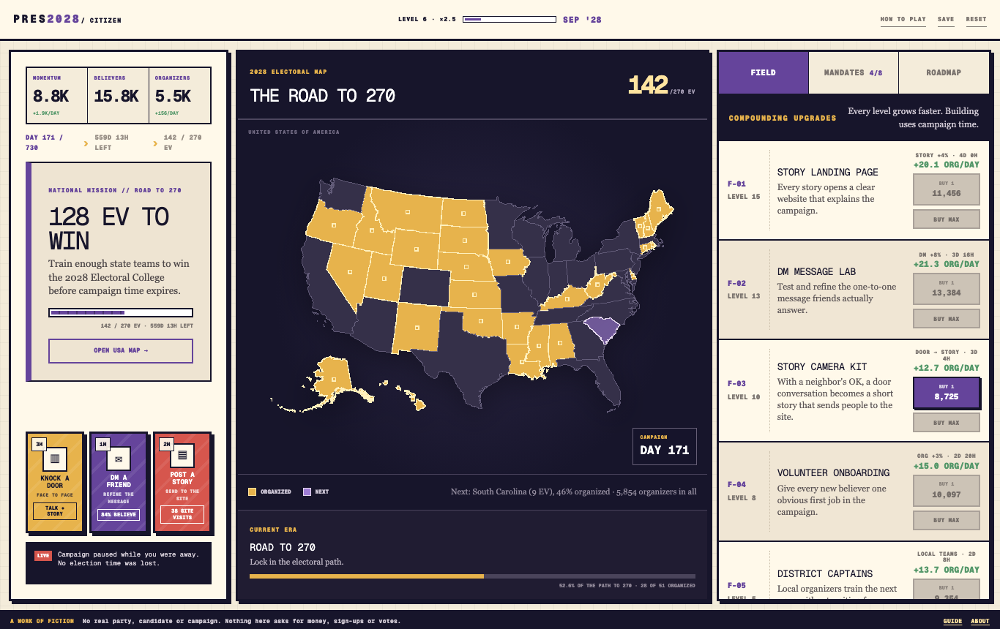

# PRES2028: Citizen — The Road to 270

**Play:** https://theguysaccount.github.io/pres2028-citizen-game/ · **Guide (electoral votes by state, rules, numbers):** [/guide/](https://theguysaccount.github.io/pres2028-citizen-game/guide/) · **Screens:** [docs/screens](docs/screens/)

A retro incremental strategy game about peaceful, party-less organizing, and a work of fiction: no real party, no candidate, no campaign.

You are an ordinary citizen with 730 campaign days. Each move uses campaign hours: knock a door, DM a friend, or post a story. Reach turns into belief, and believers become organizers. Field upgrades and eight (fictional) mandates compound that loop. Organizers win states, and every state carries its **real** electoral votes for the 2024 and 2028 elections. Reach 270 before Election Day.

At the end, a result card shows your winning day, and a challenge link dares a friend to win sooner. The campaign pauses whenever you leave. Saves stay in your browser, and a save code moves a run between devices. There is no account, no ads, no cookies, and nothing that asks for money, sign-ups or votes.



## How it runs (no human in the loop)

| Job | Workflow | When |
|---|---|---|
| Type check, unit tests, build, rendered-HTML tests and a scripted campaign in headless Chrome. Then deploy to Pages, check the live site, run a live campaign and ping IndexNow. | `pages.yml` | Every push that touches the game; by hand; or when the self-test finds the live site behind `main` |
| Rendered-HTML tests and a scripted campaign on a fresh build and on the live site. Also a staleness check, an alert issue and keep-alive. | `selftest.yml` | Weekly, on Thursday |

Each job fails safe: the last good deploy stays live. [OPERATIONS.md](OPERATIONS.md) has the details, plus the keys that need a human: a custom domain, a support link, analytics and an itch.io release.

## Layout

```
src/states.ts         the 51 electoral-vote entries (National Archives), 538 in all, 270 to win
src/engine.ts         all campaign rules as pure functions (shared by the UI, tests, scripted players, guide)
src/bot.ts            scripted players; the guide's campaign lengths and the balance tests use them
src/CitizenGame.tsx   the game UI (React), hydrated over server-rendered HTML
src/UsaMap.tsx        the electoral map as SVG (paths precomputed by scripts/make-map.mjs from us-atlas)
src/ResultPanel.tsx   the end-of-campaign card, drawn on the player's device, and the ?day= challenge link
src/pages.tsx         the guide and about pages, rendered to static HTML at build time
scripts/              build, map and share-image generators, e2e campaign, live check, IndexNow, screenshots
tests/                unit tests of the rules; rendered-HTML tests of the build
```

## Run, test, deploy

You need Node 24, which runs the TypeScript tests directly, and Chrome for the browser tests.

```bash
npm ci --ignore-scripts
npm run build && npm run serve   # http://127.0.0.1:4173/pres2028-citizen-game/
npm test                         # type check, unit tests, build, rendered-HTML tests
npm run e2e                      # a full scripted campaign in headless Chrome
npm run screens                  # screenshots into docs/screens/
```

Every push to `main` deploys through `pages.yml`; `gh workflow run pages.yml` starts one by hand. Settings are repository variables, listed in [.env.example](.env.example). `SITE_URL` is the single address setting.

## History

The game was built in July 2026 as a Next.js 16 / vinext app for Cloudflare Workers ("PRES2032: Citizen") and never deployed. This repo keeps its loop, upgrades, mandates, missions, timeline, save key and pixel interface, and renders them to static HTML for GitHub Pages. It also makes a balance pass, uses real electoral votes, renames a trademarked upgrade, and adds fiction labels, result cards and a guide. See [STATE.md](STATE.md), [DECISIONS.md](DECISIONS.md), [PRODUCT.md](PRODUCT.md) and [LAUNCH.md](LAUNCH.md).

## Licence

Code and game text: MIT. Map shapes come from us-atlas (ISC, from U.S. Census Bureau data), and electoral votes from the National Archives. Fonts are under the OFL. See [LICENSE](LICENSE).
